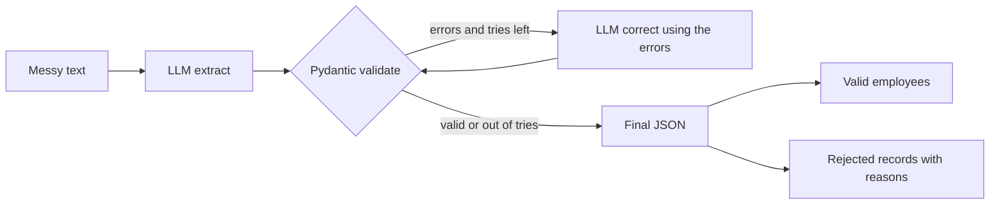
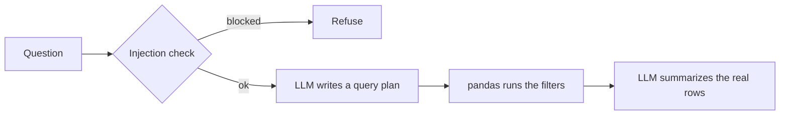

# Self Correcting Data Validation Agent

[](https://github.com/Siddhesh-Ai9797/self-correcting-data-validation-agent/actions/workflows/ci.yml)

A LangGraph agent that turns messy employee text into clean JSON that always matches a strict schema. When the model's output fails validation, the agent sends the exact errors back and asks for a fix, up to a set number of tries. Records that cannot be fixed without guessing are rejected with reasons instead of being made up. A Streamlit app also cleans CSV files and answers questions about them with real pandas queries.

## The problem

LLMs fill gaps. Ask one to extract employee records from messy notes and it will happily invent a missing ID or department. This project does the opposite:

* Every record must pass a Pydantic schema, or it does not leave the pipeline.
* Fixes are driven by the real validation errors, with a hard limit on retries.
* A record missing a required field goes to a rejected list with the reason. It is never filled in.
* Questions about data are answered by pandas, not by the model's memory.

## How it works



1. **Extract.** The LLM reads the text and returns JSON for each employee it finds.
2. **Validate.** Pydantic checks every field. IDs must be integers, ages must be 16 to 80, performance scores 0 to 10, and the department must be one of a fixed list.
3. **Correct.** If validation fails, the errors go back to the LLM with its last output, and it tries again. The loop is a LangGraph state machine with a retry limit.
4. **Finalize.** Valid records go to `employees`. Anything that would need a guessed ID, name or department goes to `rejected` with a list of reasons.

### Questions with real answers



The model never answers from memory. It only writes a small query plan with filters like equals, contains, in, at least and at most. Pandas runs that plan on the uploaded data, and the model then summarizes the rows that came back. A simple check blocks prompts that try to override instructions or pull secrets.

### CSV cleaning

The cleaning step fixes common mess without an LLM: names in odd case and spacing, ages written as words like "thirty two", salaries with symbols, dates in mixed formats, and misspelled categories matched to the right value with fuzzy matching.

## Testing

* **15 hand written messy inputs** in `test_inputs/` cover cases like word numbers, missing fields, odd dates, duplicates, conflicting values, two records in one line, and pure noise. `python -m src.eval.run_agent_suite` runs the agent on all of them and prints a summary.
* **Query benchmarks** in `src/eval/benchmarks.json` check that query plans return exactly the expected set of names.
* **Unit tests** cover the schema, the offline runner and the query engine. GitHub Actions runs them on every push.

## Tech stack

| Area | Tools |
|---|---|
| Agent | LangGraph, OpenAI gpt-4.1-mini |
| Validation | Pydantic v2 |
| Data | pandas, rapidfuzz, python-dateutil |
| App | Streamlit |
| Testing | pytest, GitHub Actions |

## Project structure

```
app.py                 Streamlit app: cleaning, questions, agent
src/
  agent/
    graph.py           LangGraph extract, validate, correct loop
    schemas.py         Employee and rejected record schemas
  core/
    cleaning.py        Rule based CSV cleaning
    query.py           Query plans and pandas execution
    security.py        Prompt injection check
  eval/                Agent stress suite and query benchmarks
  tests/, tests_agent/ Unit tests
test_inputs/           15 messy text cases
```

## Running it

```bash
pip install -r requirements.txt
export OPENAI_API_KEY="your_key"
streamlit run app.py
```

The app has three tabs: clean a CSV and download the result, ask questions about it, and run the self correcting agent on raw text.

Run the stress suite and tests:

```bash
python -m src.eval.run_agent_suite
python -m pytest -q src
```

## Author

Siddhesh Patil, MS in Artificial Intelligence, DePaul University
